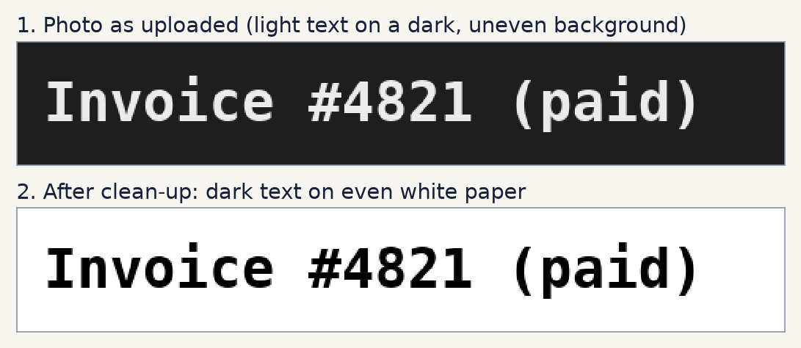
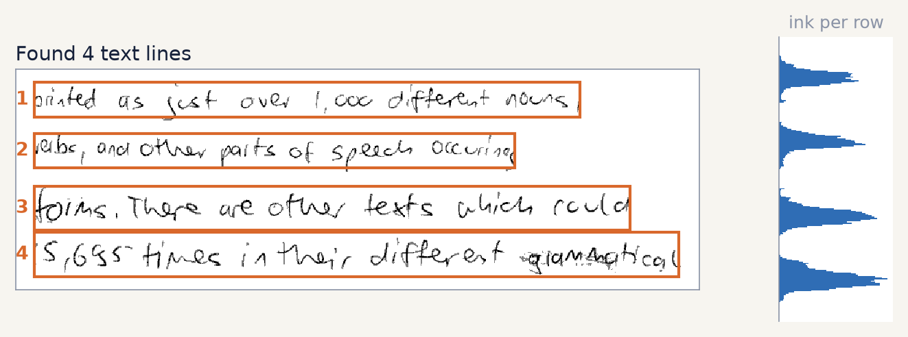
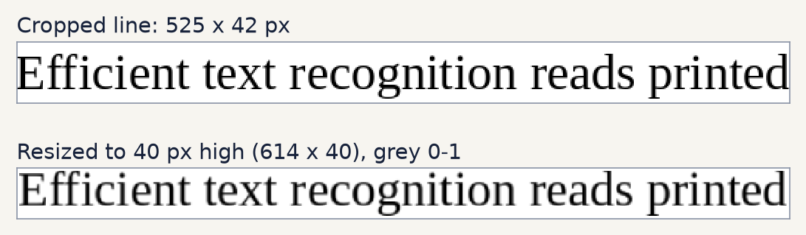
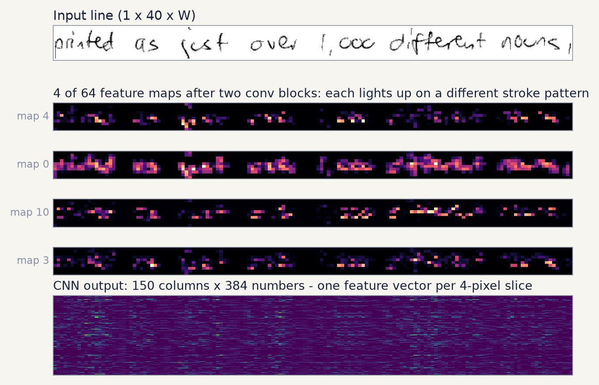
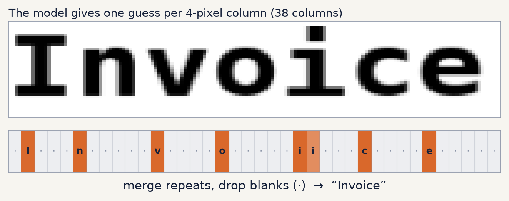
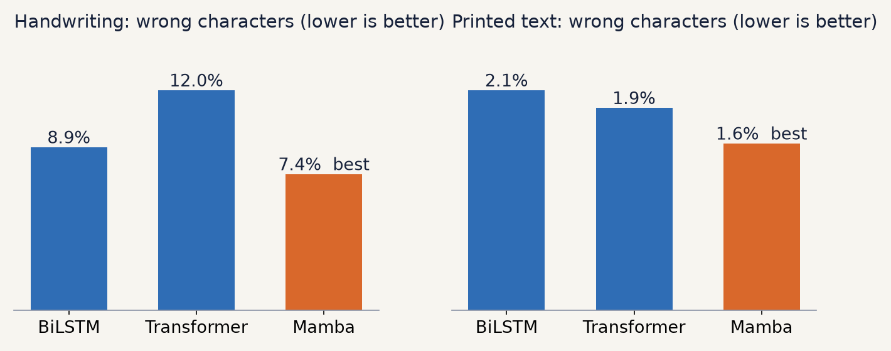

# Efficient Text Recognition

Reads **printed and handwritten text** from images. Give it a photo, a scan or a
screenshot and it returns the text, line by line.

The project is also a **fair comparison of three model designs**. Every model is
the same CNN (it looks at the pixels) followed by one of three interchangeable
*readers* (BiLSTM, Transformer or Mamba) and a CTC decoder. All three are trained
from scratch on the same data with the same recipe and tested on the same
held-out lines, so the numbers show which reader works best for this job.

No pretrained weights and no cloud services: three Python packages (`torch`,
`numpy`, `Pillow`) and one command.

```bash
python run.py
```

---

Full write-up of the comparison: [`REPORT.md`](REPORT.md). Slides:
[`presentation.pptx`](presentation.pptx) / [`presentation.pdf`](presentation.pdf).

## Contents

1. [Quick start](#quick-start)
2. [The idea: one CNN, three readers](#the-idea-one-cnn-three-readers)
3. [How it works, step by step](#how-it-works-step-by-step)
4. [Training](#training)
5. [Results](#results)
6. [Where diffusion fits](#where-diffusion-fits)
7. [Command reference](#command-reference)
8. [Project layout](#project-layout)
9. [Limits and next steps](#limits-and-next-steps)

---

## Quick start

```bash
python run.py
```

The first run installs anything missing (PyTorch with GPU support if an NVIDIA
GPU is present) and unpacks the dataset. Then it shows the start screen:

```
Every model = the same CNN (looks at the pixels) + a sequence model (reads the line in order) + CTC (turns it into letters).

  1  CNN + BiLSTM       errors per character: handwriting 8.9%, printed 2.1%  (best epoch 28)
  2  CNN + Transformer  errors per character: handwriting 12.0%, printed 1.9%  (best epoch 28)
  3  CNN + Mamba        errors per character: handwriting 7.4%, printed 1.6%  (best epoch 30)

  1-3  open the web app with that model
  t    train a model from scratch
  c    compare all trained models side by side
  q    quit

Your choice [3]:
```

- **1, 2 or 3** opens the web app at <http://127.0.0.1:8000> with that model.
  Upload, paste or drop an image, click a sample, or write on the drawing pad.
  If the model is not trained yet, it offers to train it first.
- **t** trains a model from scratch (about 20 minutes on a laptop RTX 3050,
  several hours on a CPU). Progress is saved every epoch.
- **c** scores every trained model on the same held-out lines and prints a table.

Trained models for all three readers are included in `models/`, so nothing
has to be trained before use.

---

## The idea: one CNN, three readers

A common picture of OCR is a chain of replacements: try a CNN, and if it is not
good enough switch to a Transformer, then to Mamba or diffusion. That is not how
these models are built. **Every modern line recogniser starts with a CNN**,
including Transformer and Mamba ones. What changes is the **sequence model that
reads the CNN's output in order**:

```
 line image ──► CNN ──────────► reader ──────────────► CTC ──► text
 (40 px tall)   "the eyes"      BiLSTM | Transformer |  merge
                same for all    Mamba  (only this      repeats,
                                part changes)          drop blanks
```

So this project keeps the CNN, the data, the training recipe, the loss and the
test lines identical, and swaps only the reader. That turns "which is better?"
into a measurement instead of an opinion.

| Reader (`--arch`) | How it reads the columns | Strong point | Weak point |
|---|---|---|---|
| **BiLSTM** (`lstm`) | one at a time, left→right and right→left, carrying a memory | small, learns well from little data; the classic CRNN design (2015) | steps run one after another, less parallel training |
| **Transformer** (`transformer`) | every column looks at every other column at once (self-attention) | fully parallel; the strongest design when pre-trained on huge data | needs lots of data; cost grows with length² |
| **Mamba** (`mamba`) | in order, with a memory that chooses per column what to keep or forget (selective state space) | cost grows linearly with length; parallel training | new (2023–24), less proven for OCR |

All three are about 2 million parameters, so none wins by being bigger.

---

## How it works, step by step

Steps 1–3 are fixed image processing (no learning). Steps 4–6 are one neural
network trained end to end. Every picture below is produced from the real code
and the real trained model by `tools/make_figures.py`.

### Step 1: Clean the page



The network was trained on dark ink on light paper, so every input is turned
into that first (`clean()` in `ocr/predict.py`):

- **Flip dark themes.** If most of the image is dark, invert it.
- **Remove shadows.** A blurred maximum filter estimates the paper brightness
  around every pixel; dividing by it evens out shadows and uneven lighting.
- **Stretch the contrast.** The darkest ink becomes black, so faint pencil and
  dark marker look alike.

### Step 2: Find the lines



The model reads one line at a time (`find_lines()` in `ocr/predict.py`):

- Otsu's method picks a threshold between ink and paper, then the ink pixels in
  every row are counted (the blue chart).
- Runs of busy rows are lines. Very thin runs (dots, accents) are merged into
  the neighbouring line.
- Each box grows a little so tails of g, y and p are kept, then is trimmed to
  the ink on the left and right.

### Step 3: Resize to 40 pixels tall



Every line is scaled to 40 px high (36 px of text plus a 2 px border), keeping
its aspect ratio, so a longer line simply gives more columns to read. Grey
levels become numbers between 0 and 1 (`normalize_line()` and `to_tensor()` in
`ocr/dataset.py`). Training and prediction use the same functions.

### Step 4: CNN, the eyes



Five 3×3 convolution layers (32 → 64 → 96 → 128 → 192 filters, each with batch
norm and ReLU) learn to respond to edges, curves, loops and stroke ends. Max
pooling shrinks the height from 40 to 2 and the width by 4, so **every 4-pixel
slice of the line becomes one column described by 192 × 2 = 384 numbers**. The
magenta strips above are real feature maps from the trained model; the bottom
image is the whole 384 × 150 output for that line.

The CNN only sees a small neighbourhood, so it recognises stroke shapes, not
words. Putting the letters in order is the reader's job.

### Step 5: The reader (the only part that differs)

The reader turns the sequence of 384-number columns into a sequence of
192-number columns that also carry context from the rest of the line
(`ocr/model.py`):

- **BiLSTM:** 2 layers, 192 units in each direction. The original CRNN.
- **Transformer:** a 4-layer encoder with 4 attention heads, width 192,
  sinusoidal position encoding and pre-normalisation (stable when trained from
  scratch).
- **Mamba:** 6 Mamba-2 blocks of width 192. Each block keeps a memory `h` that
  is updated column by column:

  ```
  h[t] = Ā[t] · h[t-1] + B̄[t] · x[t]
  y[t] = C[t] · h[t]
  ```

  Ā, B̄ and C are computed from the input itself ("selective"), so the model
  decides what to keep and what to forget. Mamba reads in one direction, so
  every other layer reads the line backwards, letting each column see both
  sides.

  The official `mamba-ssm` package needs custom CUDA kernels that do not install
  on Windows, so this project has a plain-PyTorch Mamba. A first version stepped
  through the columns in a Python loop: 57 s per training step and 4.5 GB of
  GPU memory. The final version computes the same recurrence as one matrix
  product (Mamba-2's "SSD" form): **0.18 s per step and 1.3 GB**.
  `tests/test_model.py` checks that both forms give the same output.

### Step 6: CTC, from column guesses to text



A final linear layer makes one guess per column out of 84 choices: 83
characters plus a special **blank** ("no new letter here"). Decoding is simple:
**merge repeated guesses, then drop the blanks**. Above, the two `i` guesses
merge into one and the blanks disappear, giving "Invoice". A blank between two
equal letters keeps real doubles such as the "ll" in "hello".

For training, the **CTC loss** adds up the probability of every alignment that
spells the correct text, so the training data needs only the text of each line,
not where each letter is.

---

## Training

### Data (`data/dataset.zip`, 28 MB, 27,373 images)

| Part | Images | What it is |
|---|---:|---|
| `handwritten/` | 10,373 lines | **IAM Handwriting Database** lines, real handwriting by about 650 writers, from [Teklia/IAM-line](https://huggingface.co/datasets/Teklia/IAM-line) (MIT licence), resized to 40 px high |
| `printed/` | 17,000 words | dictionary words, numbers and punctuation rendered in 170 open fonts (the MJSynth recipe). The trainer joins random words of one font into lines, so they become an unlimited supply of printed lines |

Held out for testing: the official IAM validation lines and 5% of the printed
words. Nothing from these is ever trained on.

### Recipe (identical for all three readers)

- 30 epochs × 250 batches × 32 lines, a mix of 50% handwritten, 25% long printed and 25% short printed lines
- on-the-fly augmentation: slant, stretch, blur, thicker or thinner strokes, faded ink, grey paper, noise
- AdamW, learning rate 1e-3 with a one-cycle schedule, gradient clipping, mixed precision on GPU
- after every epoch the model is scored on the held-out lines; the best epoch is saved
- progress is saved every epoch, and `python run.py --resume --arch <name>` continues an interrupted run

Each reader is saved to its own file (`models/ocr_crnn.pt`,
`models/ocr_transformer.pt`, `models/ocr_mamba.pt`), so training one never
overwrites another.

---

## Results

Measured with `python run.py --compare` on the held-out lines: 960
handwritten IAM validation lines and 1,920 printed lines in random fonts.



| Model | Size | Handwriting: wrong characters | Handwritten lines with no mistake | Printed: wrong characters | Printed lines with no mistake | Speed (ms per line) | Training time |
|---|---:|---:|---:|---:|---:|---:|---:|
| CNN + BiLSTM | 2.21 M | 8.9% | 15.9% | 2.1% | 80.1% | 3.1 | about 3 h (CPU) |
| CNN + Transformer | 2.28 M | 12.0% | 6.4% | 1.9% | 83.1% | **0.9** | 21 min (GPU) |
| CNN + Mamba | **1.89 M** | **7.4%** | **20.1%** | **1.6%** | **88.1%** | 1.6 | 18 min (GPU) |

Speed is the time per line for a batch of 32 long printed lines on a laptop
RTX 3050 GPU. GPU training times were measured on that GPU; the BiLSTM was
trained earlier on a CPU with the same recipe.

**What this means**

- **Mamba is the most accurate reader**, and the smallest. It makes about 17%
  fewer handwriting mistakes than the BiLSTM (7.4% against 8.9%) and gets one
  in five handwritten lines and nearly nine in ten printed lines completely
  right. Its best epoch was the last one, so longer training would probably
  improve it further.
- **The Transformer is the fastest but the weakest on handwriting** (12.0%).
  This is the expected result for a Transformer trained from scratch on about
  10,000 handwritten lines: Transformers shine when pre-trained on millions of
  images, which this project deliberately does not do.
- **The BiLSTM is a solid baseline**, but slowest at prediction time, because
  it must step through the columns one by one.
- On printed text all three are close (1.6–2.1%). The differences that matter
  are on handwriting.

Each model was trained once (same seed). Small gaps, such as 1.9% against 2.1%
on printed text, could change with another training run; the handwriting gap
between Mamba and the Transformer is large enough not to.

---

## Where diffusion fits

Diffusion models generate images: they learn to turn noise into a realistic
picture step by step. They are not text readers. For OCR they are useful
**around** the reader:

1. **More training data.** A diffusion model trained on IAM can write any
   sentence in many handwriting styles, giving the reader thousands of extra
   labelled lines. More varied handwriting is the most direct way to lower the
   handwriting error rate.
2. **Better input.** It can restore blurry or stained scans before step 1.

Both are good candidates for a second phase. Neither replaces the reader, and
both need a separate, much longer GPU training run.

---

## Command reference

Everything goes through `run.py`. With no options it shows the start screen;
the options below do the same things without the menu (useful in scripts).

| Command | What it does |
|---|---|
| `python run.py` | start screen: pick a model, train, compare |
| `python run.py --arch mamba` | open the web app with that reader (`lstm`, `transformer`, `mamba`) |
| `python run.py --train --arch transformer` | train that reader from scratch, then open the app |
| `python run.py --resume --arch mamba` | continue an interrupted training run |
| `python run.py --compare` | score every trained model on the same held-out lines |
| `python run.py --image photo.png --arch lstm` | print the text of one image and exit |
| `python run.py --epochs 10` | shorter or longer training |
| `python run.py --port 9000 --no-browser` | different port, do not open a browser |

Other scripts:

| Command | What it does |
|---|---|
| `python tests/test_model.py` | quick checks: every reader runs, Mamba's matrix form equals its step-by-step form, the shipped model loads |
| `python tools/make_figures.py` | redraws the pictures in `docs/figures/` (needs `pip install matplotlib`) |

**Add your own images:** put them in a new folder inside `dataset/`, append rows
to `dataset/labels.csv` (`file,text,kind,font,split` with `kind=handwritten`
for whole-line images, `font` empty, `split=train`), then retrain.

---

## Project layout

```
run.py                  the only file you run: start screen, training, web app
requirements.txt        torch, numpy, Pillow
data/dataset.zip        the dataset (28 MB)
dataset/                extracted dataset, created by run.py, git-ignored
models/                 one trained model per reader
ocr/
  config.py             paths, character set, model list, training settings
  dataset.py            unzip, load, augment, build training batches   (step 3)
  model.py              CNN + BiLSTM / Transformer / Mamba + CTC decode (steps 4-6)
  train.py              training loop, evaluation, comparison table
  predict.py            clean the image, find lines, read each line     (steps 1-2)
  server.py             local web app (Python standard library)
  web/index.html        the page
tests/test_model.py     quick model checks
tools/make_figures.py   draws docs/figures/
tools/build_dataset.py  how data/dataset.zip was built (not needed to run)
docs/figures/           the pictures used in this README
REPORT.md               project report: brief, method, results, recommendations
presentation.pptx       slide deck (16 slides with speaker notes); presentation.pdf is the same as PDF
```

---

## Limits and next steps

- **Layout:** lines are found from the ink per row, so text should be roughly
  straight and in a single column. Rotated photos, multi-column pages and text
  over busy backgrounds need a learned text detector.
- **Characters:** English letters, digits and common punctuation only.
- **Handwriting** is the weak spot for every reader: the training set has only
  about 10,000 handwritten lines. More handwriting data (real, or generated by
  a diffusion model as above) would help all three readers more than any change
  of architecture.
- **No language model:** the output is exactly what the network reads. A small
  word-level language model or beam search over CTC would fix many
  near-misses such as "pinted" → "printed".
