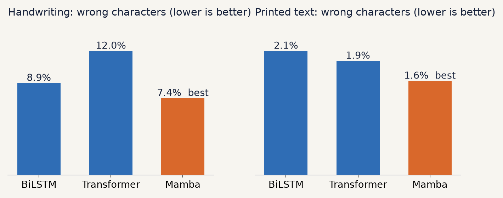

# Project Report: Comparing CNN + BiLSTM, CNN + Transformer and CNN + Mamba for Text Recognition

**Date:** 13 November 2026
**Project:** Efficient Text Recognition (printed and handwritten text from images)
**Deliverables:** code (`run.py`, `ocr/`), three trained models (`models/`), this report,
`README.md`, slides (`presentation.pptx`, `presentation.pdf`)

---

## 1. Summary

The client asked whether text recognition (OCR) works better with a CNN, a
Transformer, or a newer method such as Mamba or diffusion, with the idea of
moving to the next method if the previous one did not work.

We built one recognition system and made the part that reads the text
switchable. All three versions share the same CNN, the same data, the same
training recipe and the same test lines, so the only difference is the
sequence model ("reader"):

| Model | Handwriting: wrong characters | Printed: wrong characters | Size |
|---|---:|---:|---:|
| CNN + BiLSTM (the original) | 8.9% | 2.1% | 2.21 M parameters |
| CNN + Transformer | 12.0% | 1.9% | 2.28 M parameters |
| **CNN + Mamba** | **7.4%** | **1.6%** | **1.89 M parameters** |

**Key findings**

1. **CNN + Mamba is the most accurate model**, on both handwriting and printed
   text, and it is also the smallest. It makes about 17% fewer handwriting
   mistakes than the original BiLSTM model.
2. **CNN + Transformer is the fastest at prediction time but the weakest on
   handwriting.** This is expected when a Transformer is trained from scratch
   on about 10,000 handwritten lines, without large-scale pre-training.
3. **The CNN is never replaced.** It is the "eyes" in all three designs. The
   brief's "CNN, then Transformer, then Mamba" chain is better understood as a
   choice of reader on top of one CNN.
4. **Diffusion is not a text reader.** It generates images. Its best use here is
   creating extra handwriting training data or restoring poor scans, a
   possible second phase.

**Recommendation:** use CNN + Mamba as the default model (already the default
in `run.py`). The largest remaining gain will come from more handwriting
training data, not from another architecture.

---

## 2. Objective and how the brief was interpreted

**Brief (as received):** "For OCR, try a CNN. If it does not work properly, use
the Transformer method. Then use a Mamba or diffusion based method. Which is
better?"

**How OCR models are built in practice.** A modern line recognizer has three
parts:

```
line image ──► CNN ──────────► sequence model ─────────► CTC ──► text
               looks at pixels  reads the columns in order  turns column guesses into letters
```

Transformer-based and Mamba-based OCR models also start with a CNN, or a
similar image encoder. So "CNN or Transformer or Mamba" is really a choice of
the **sequence model** after the CNN. We therefore turned the brief into a
controlled comparison:

- keep the CNN, data, augmentation, loss, optimiser, training length and test
  lines identical;
- swap only the sequence model: BiLSTM, Transformer or Mamba;
- measure accuracy, size and speed for each.

Diffusion was assessed separately (section 8) because it is a different kind of
model.

---

## 3. The system, step by step

| Step | What happens | Learned? | Code |
|---|---|---|---|
| 1. Clean | invert dark themes, divide out shadows, stretch contrast | no | `ocr/predict.py` `clean()` |
| 2. Find lines | count ink pixels per row; peaks are lines | no | `ocr/predict.py` `find_lines()` |
| 3. Resize | every line scaled to 40 px high, any width | no | `ocr/dataset.py` `normalize_line()` |
| 4. CNN | 5 conv layers turn the line into one 384-number vector per 4-pixel column | yes | `ocr/model.py` `CRNN.cnn` |
| 5. Reader | BiLSTM, Transformer or Mamba reads the columns in order | yes | `ocr/model.py` |
| 6. CTC | one guess per column (83 characters + blank); merge repeats, drop blanks | yes | `ocr/model.py` `greedy_decode()` |

Pictures of every step, made from the real models, are in `docs/figures/` and
explained in `README.md`.

---

## 4. The three readers

| | BiLSTM | Transformer | Mamba |
|---|---|---|---|
| Idea | reads column by column in both directions, carrying a memory | every column attends to every other column at once | reads in order with a memory whose update depends on the input ("selective state space") |
| Configuration | 2 layers, 192 units per direction | 4 encoder layers, width 192, 4 heads, feed-forward 768, sine position encoding, pre-norm | 6 Mamba-2 blocks, width 192, state size 16, 8 heads of 48; direction flipped on every other layer |
| Total parameters (with CNN) | 2.21 M | 2.28 M | 1.89 M |
| Cost vs line length | linear, but sequential | quadratic, fully parallel | linear, parallel training |

All three are about the same size, so none wins simply by being bigger.

**Mamba implementation note.** The official `mamba-ssm` package needs custom
CUDA kernels that do not install on Windows, so the project has its own
Mamba-2 block in plain PyTorch. The first version stepped through the columns
in a Python loop and took 57 s per training step with 4.5 GB of GPU memory,
more than the 4 GB GPU has. The final version computes the same recurrence as
one matrix product (Mamba-2's "SSD" form): **0.18 s per step and 1.3 GB**.
`tests/test_model.py` checks that the matrix form and the step-by-step loop
give the same output.

---

## 5. Experimental setup

**Data** (`data/dataset.zip`, 27,373 images)

- 10,373 handwritten lines from the IAM Handwriting Database (about 650
  writers), from Teklia/IAM-line (MIT licence).
- 17,000 printed words in 170 open fonts, joined into random lines during
  training.

**Test set (never trained on):** the official IAM validation lines (960 used)
and 5% of the printed words, built into 1,920 printed lines with a fixed seed.

**Training recipe (identical for all three)**

- 30 epochs × 250 batches × 32 lines (240,000 lines seen), 50% handwritten,
  25% long printed, 25% short printed lines.
- Augmentation: slant, stretch, blur, thicker or thinner strokes, faded ink,
  grey paper, noise.
- AdamW, one-cycle learning rate with a peak of 0.001, weight decay 1e-4,
  gradient clipping at 5, CTC loss.
- After every epoch the model is scored on the test set, and the epoch with the
  lowest combined error is kept.

**Hardware and software:** Windows 11, NVIDIA GeForce RTX 3050 Laptop GPU
(4 GB), PyTorch 2.11 with CUDA 12.8, Python 3.14. The Transformer and Mamba
were trained on this GPU with mixed precision. The BiLSTM model shipped earlier
was trained on a CPU with the same code and recipe.

**Metrics**

- **Character error rate (CER):** edit distance between the model's text and
  the true text, divided by the length of the true text. Lower is better.
- **Line accuracy:** share of lines read with no mistake at all.
- **Speed:** milliseconds per line for a batch of 32 long printed lines on the
  GPU, averaged over 5 runs after a warm-up.

Reproduce with `python run.py --compare`.

---

## 6. Results



| Model | Size | Handwriting CER | Handwritten lines perfect | Printed CER | Printed lines perfect | ms per line | Best epoch | Training time |
|---|---:|---:|---:|---:|---:|---:|---:|---:|
| CNN + BiLSTM | 2.21 M | 8.9% | 15.9% | 2.1% | 80.1% | 3.1 | 28 | about 3 h (CPU) |
| CNN + Transformer | 2.28 M | 12.0% | 6.4% | 1.9% | 83.1% | **0.9** | 28 | 21 min (GPU) |
| CNN + Mamba | **1.89 M** | **7.4%** | **20.1%** | **1.6%** | **88.1%** | 1.6 | 30 | 18 min (GPU) |

### Learning speed

Test error (handwriting / printed) after selected epochs:

| Epoch | Transformer | Mamba |
|---:|---:|---:|
| 1 | 100% / 100% | 80.7% / 92.3% |
| 2 | 96.5% / 99.2% | 35.3% / 17.0% |
| 5 | 26.9% / 8.3% | 17.9% / 6.2% |
| 10 | 18.6% / 3.6% | 11.6% / 3.1% |
| 20 | 13.9% / 2.0% | 8.7% / 2.2% |
| 30 | 14.0% / 1.4% | 7.4% / 1.6% |

Mamba learns much faster: after 2 epochs it already reads most characters,
while the Transformer still outputs almost nothing. Mamba was still improving
at epoch 30. The Transformer's handwriting error levelled off at about 12–14%.

### Same handwritten paragraph, three readers

`samples/handwritten_paragraph.png` is four IAM validation lines, which no
model trained on. Their true text (IAM labels, which put a space before
punctuation) is:

```
printed as just over 1,000 different nouns ,
verbs , and other parts of speech occurring
forms . There are other texts which could
15,695 times in their different grammatical
```

What each model read:

| BiLSTM | Transformer | Mamba |
|---|---|---|
| pinted as just over l ,oo diftereut nous , | pinted as jcst over I , coc different nouns , | pinted as just oves I , ooe different nouns , |
| veibs , and other parts of speech occuring | reibs , and oter paits of speech 0rcurio | veibs , and other parts of speech occuring |
| foims , There are other texts which rould | foims , There are other texts which could | forms . There are other texts which rould |
| (S,66s-timec in their different ygramsatical | 1S ,6gstimes in their differest glamsgtcal | i5,69stimes in their differest giambatical |

All three still make mistakes on untidy handwriting. Numbers such as "15,695"
are hard for every model because the training set has few handwritten digits.

---

## 7. Discussion

**Why Mamba wins.** Mamba combines two useful properties. Like the BiLSTM, it
carries a memory along the line, which suits text read in order. Like a
Transformer, it trains in parallel, and its input-dependent ("selective")
memory lets it decide when to keep or reset context, for example at spaces.
With alternating reading directions, each column sees context from both sides.

**Why the Transformer is weak on handwriting.** Self-attention has no built-in
idea that neighbouring columns belong together; it must learn this from data.
With about 10,000 handwritten lines that is not enough. Strong Transformer OCR
systems, such as TrOCR, are pre-trained on hundreds of millions of images. On
printed text, where the training supply is effectively unlimited, the
Transformer does as well as the others.

**How far to trust the numbers.**

- Each model was trained once with the same seed. Differences of a few tenths
  of a percentage point (printed CER 1.6–2.1%) could change with another run.
  The handwriting differences (7.4% against 8.9% against 12.0%) are large
  enough to trust.
- The BiLSTM was trained on a CPU (full precision), the other two on the GPU
  (mixed precision). The recipe and data are identical; we do not expect this
  to change the ranking, but a GPU retrain of the BiLSTM would remove the doubt.
- The test set was also used to pick each model's best epoch, which can make
  all three look slightly better than on truly unseen data. It affects all
  three the same way.

---

## 8. Where diffusion fits

Diffusion models learn to turn random noise into realistic images. They do not
read text, and using them as recognizers is slow and unusual. They can still
help this project around the reader:

1. **Synthetic handwriting.** A diffusion model trained on IAM can write any
   sentence in many styles, producing thousands of extra labelled training
   lines. Handwriting accuracy is the weak spot for every reader, so this is the
   most promising use.
2. **Scan restoration.** Cleaning blur, stains and fold marks before step 1.

Both need their own, much longer GPU training run. We recommend them as a
possible phase 2, not as a replacement for the reader.

---

## 9. Limitations

- **Layout:** lines are found from the ink profile, so text must be roughly
  straight and in one column.
- **Characters:** English letters, digits and common punctuation only.
- **No language model:** output is exactly what the network reads, so
  near-misses such as "pinted" for "printed" are not corrected.
- **Handwritten digits and rare styles** are weak because they are rare in the
  training data.

---

## 10. Recommendations and next steps

| When | Action | Expected effect |
|---|---|---|
| Now | Use CNN + Mamba as the default (done in `run.py`) | best accuracy, smallest model |
| Next | Train Mamba for longer (for example 60 epochs; it was still improving) | lower error, about 40 min on the laptop GPU |
| Next | Add beam search with a small word-level language model over the CTC output | fixes many near-misses |
| Next | Retrain the BiLSTM on the GPU and repeat each run with 2–3 seeds | firmer comparison |
| Phase 2 | Generate extra handwriting with a diffusion model, or add more real handwriting | biggest expected gain on handwriting |
| Phase 2 | Replace the ink-profile line finder with a learned text detector | rotated photos, multi-column pages |

**Questions for the client**

1. What error rate is good enough for the intended use?
2. Does handwriting or printed text matter more?
3. Will it run on a GPU, or must it run on a CPU only?

---

## 11. How to reproduce

```bash
python run.py                              # start screen: use, train or compare models
python run.py --train --arch mamba         # retrain one reader from scratch (lstm, transformer, mamba)
python run.py --compare                    # the results table in section 6
python tests/test_model.py                 # quick checks
python tools/make_figures.py               # redraw docs/figures (needs matplotlib)
```
